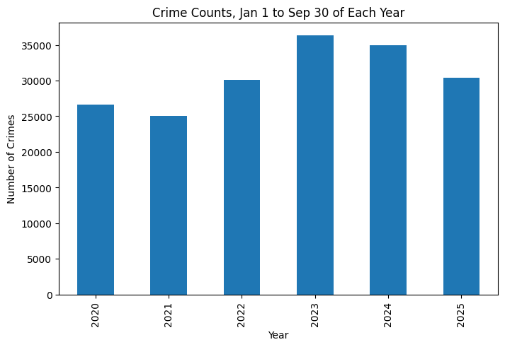
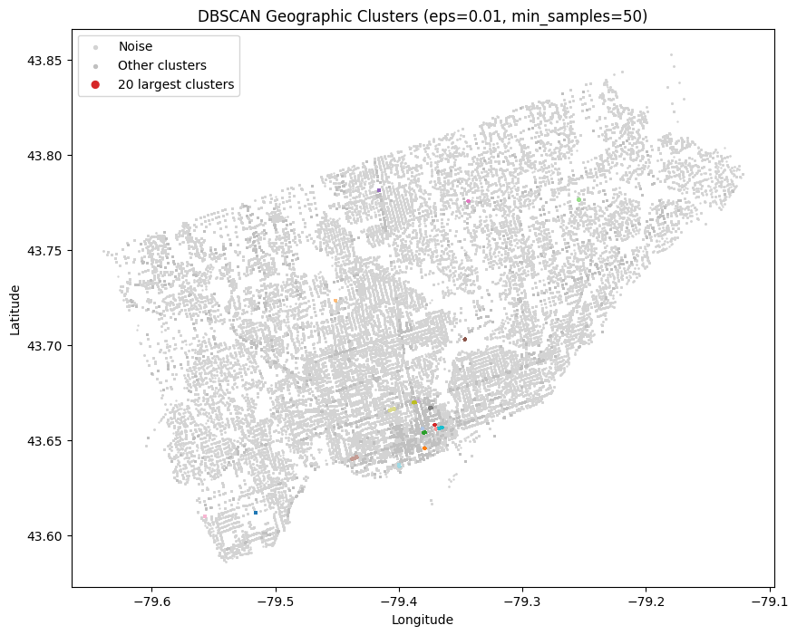
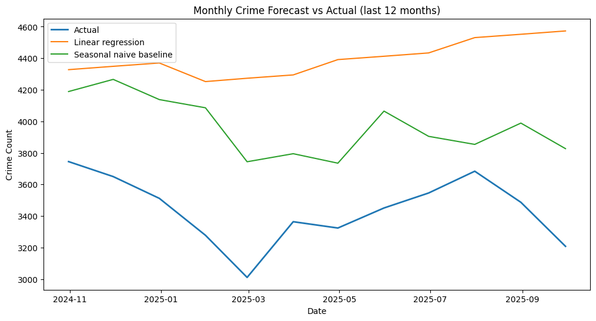

# Toronto-Crime-Clustering-Forecasting

Python analysis of the Toronto Police Service's Major Crime Indicators dataset (235,507 incidents, 2020 to Sept 2025): geographic clustering with K-Means and DBSCAN, PCA of neighbourhood crime profiles, and a monthly forecast compared against a seasonal baseline.

**Source:** Toronto Police Major Crime Indicators (CSV download): https://ckan0.cf.opendata.inter.prod-toronto.ca/dataset/6909ea60-ef0e-465f-b5d0-43106b6b9130/resource/8084057c-b2da-486c-b517-38f4e314b820/download/major-crime-indicators.csv. Downloaded Nov 2026; the data used here runs through Sept 30, 2025.

## What the notebook does

1. Cleans the data and keeps incidents from 2020 onward.
2. Explores crime counts by year, category and neighbourhood.
3. Groups incidents by location with K-Means and DBSCAN.
4. Compares neighbourhoods by crime mix with PCA.
5. Forecasts monthly crime counts and tests the forecast on the last 12 months.
6. Builds an interactive map of a random sample of incidents, coloured by crime category.

## Files

- `Crime_Pattern_Clustering_and_Forecasting.ipynb` – the full analysis, with outputs
- `crime_map.html` – the interactive map (download it and open it in a browser)
- `Crime_map_example.png` – an example of the interactive map
- `requirements.txt` – Python libraries used
- `forecast_vs_actual.png`, `counts_jan_to_sep.png`, `dbscan_clusters.png` – charts used below

## Cleaning decisions

- Parsed the occurrence date as a date; unreadable dates became missing.
- Removed 6,680 of 452,949 rows with a missing date or coordinates.
- Excluded 210,762 rows that occurred before January 1, 2020, leaving 235,507 incidents from 2020-01-01 to 2025-09-30.
- The data stops in September 2025, so 2025 is labelled as a partial year, and a second chart compares Jan 1 to Sept 30 across every year.
- Standardized latitude and longitude before clustering so both count equally.

## Selected findings

- **Crime counts fell after 2023:** comparing Jan 1 to Sept 30 in each year, totals peaked at about 36,000 in 2023 and dropped to about 30,000 in 2025.
- **K-Means:** k=3 had the highest silhouette score (0.4646) among k=2 to 12, splitting the city into three broad areas of 113,321, 60,486 and 61,700 incidents.
- **DBSCAN:** the first setting I tried (eps=0.03, min_samples=20) put 45.6% of clustered incidents into one cluster. With eps=0.01 and min_samples=50 the result is 977 clusters with 54.7% noise, and the largest cluster holds 2.2% of clustered incidents. Stricter settings (min_samples of 100, 200 and 500) left 73.7%, 88.0% and 96.3% of incidents as noise, so I kept eps=0.01, min_samples=50.
- **Largest DBSCAN clusters:** the biggest has 2,391 incidents (Mimico-Queensway), about three times the next largest (821). Six of the ten largest are in or near the downtown core.
- **PCA:** the first two components explain 89.3% of variance (72.2% and 17.1%). PC1 is positive for all five crime categories, so it mostly reflects overall volume. PC2 separates auto theft from assault, and West Humber-Clairville stands out with 3,561 auto thefts, compared with 166 to 1,243 in the other seven labelled neighbourhoods.
- **Forecast:** tested on October 2024 to September 2025 (average month: 3,438 incidents). The linear regression on month, year and quarter had an MAE of 958.3 (27.9% of an average month). The seasonal baseline, which predicts each month using the same month one year earlier, had an MAE of 527.8 (15.3%). Both over-predicted in all 12 months. The regression likely did worse because it extended the rise from 2020 to 2023 while counts fell afterward.







## Limitations

- The data covers reported incidents only, and neighbourhood counts are raw counts, not rates per person.
- Public incident locations are approximate; points line up along streets rather than marking exact addresses.
- K-Means and DBSCAN use coordinates only, so the clusters show where incidents were recorded, not how risky an area is.
- The forecast is tested on a single 12-month window, and the seasonal baseline is a simple benchmark.
- The interactive map has no street background to make it accessible without third party services.

## Reproduce

The CSV is not included. Download it from the source link above, save it as `major-crime-indicators.csv` next to the notebook, then:

```bash
pip install -r requirements.txt
jupyter notebook Crime_Pattern_Clustering_and_Forecasting.ipynb
```
